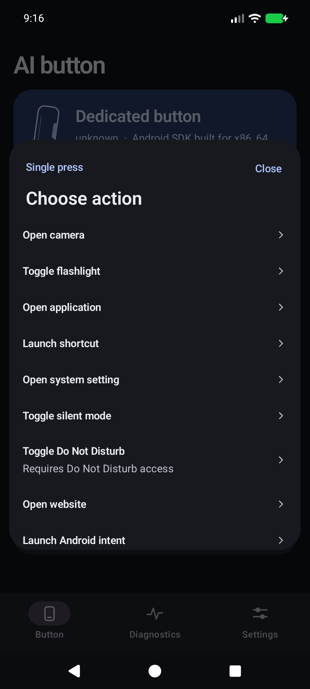

# Xiaomi AI Button Remapper

Assign the physical AI button on a Xiaomi 18 Pro to Camera, Screenshot, an app shortcut, media controls, or an action sequence. The app reads the physical key through Shizuku on compatible HyperOS builds. Root is unnecessary.

[Download the latest signed APK](https://github.com/migwynkriid13/Xiaomi-AI-Button-Remapper/releases/latest/download/Xiaomi-AI-Button-Remapper.apk) · [All releases](https://github.com/migwynkriid13/Xiaomi-AI-Button-Remapper/releases)

 

## Set up on Android 11 or later

1. Install the release APK. Start Shizuku using its in-app wireless debugging setup. If you already use Key Mapper Expert mode for the AI button, stop its Expert System Bridge before testing. [Shizuku setup guide](https://shizuku.rikka.app/guide/setup/)
2. Open Xiaomi AI Button Remapper and tap **Grant Shizuku access**. Once you approve the request, press the AI button and look for **DOWN** and **UP** on the Button page. The test leaves Xiaomi's action available. Tap **Test button** to repeat it.
3. Choose **Open camera** for the single press, turn on **Remap button**, and allow the **Button remapping** notification. It provides **Stop now** while remapping is active. To use screenshots, choose **Button actions → Take screenshot** for a gesture.
4. For more troubleshooting details, turn on **Enable diagnostics** in Settings and open the Diagnostics tab.

The helper locates a physical `gpio-keys` device advertising Linux EV_KEY 689 (`KEY_MACRO_RECORD_STOP`, `0x2B1`). It creates a virtual mirror for the other input events before grabbing the device. If setup fails, the helper closes its descriptors so Xiaomi can continue handling the button.

This app needs Shizuku running for the whole session. Key Mapper's Expert mode can continue through a separate System Bridge process after Shizuku stops. [Key Mapper System Bridge startup](https://github.com/keymapperorg/KeyMapper/blob/8073a40dd548c29f70105022224a6ed1db4a18ae/sysbridge/src/main/java/io/github/sds100/keymapper/sysbridge/starter/SystemBridgeStarter.kt#L85-L103)

Camera and Screenshot can run through Shizuku. Enable the optional accessibility service if you use configured screen interactions or foreground app profiles. See the [physical test procedure](docs/device-testing.md) and [verification record](docs/verification.md).

When moving from the original `v0.1.0-preview.1` debug-signed APK, export your settings, uninstall that preview, install this release, then import. The official signed releases use the same certificate and normally update in place.

## Actions and options

- **Apps, shortcuts and Settings.** Search installed launchable apps, shortcut creators, and supported Settings destinations. Android provides app and shortcut artwork. Launcher-published shortcuts require shortcut-host access. Legacy creators can supply the selected shortcut's own artwork.
- **Device and navigation.** Camera, screenshot, flashlight and supported torch strength, Home, Back, Recents, app menu, D-pad navigation, lock screen, Quick Settings and notification shade. Some options depend on the Android version. Connectivity changes can open a system panel for confirmation.
- **Media and sound.** Playback and seek actions, including actions that target a particular installed media player. Per-app media and notification dismissal use Android's optional notification access. Choose a ringtone or audio file, adjust a volume stream, control the ringer, or change Do Not Disturb with permission.
- **App profiles and conditions.** Override any gesture for a foreground app. The other gestures continue to use their defaults. Add per-gesture conditions for screen state, lock, media, Wi-Fi, charging, orientation or headphones. A failed condition skips the mapped action. Turn on **Also run Xiaomi's action** to pass through the physical button while remapping is enabled.
- **Automation.** Run a sequence of up to 12 actions with delays and repetitions. Other options include selected touch and editor operations, UI element interaction, URL, Android intents, HTTP requests, local variables, and supported phone or SMS actions. The picker shows extra access when an action needs it.

The app reads the active window's package for an app profile when a press begins. A configured app element or shade action inspects the active unlocked window only when it runs and **UI interactions** is on. The app does not store window contents or record typed text. Accessibility setup grants these capabilities through one Android service. No analytics or telemetry are collected. A configured HTTP action sends the request you provided when its gesture runs. Exported JSON may contain endpoint details, text, or phone numbers.

Previously saved custom shell and retired privileged mappings appear as unavailable when importing those older backups.

## Background operation and stop controls

Remapping runs in a visible foreground session with a Shizuku helper and a watchdog. You can close the settings screen. Stopping the helper or Shizuku ends remapping and releases the grab. After a restart, start Shizuku and tap **Resume remapping** on the Button page. HyperOS controls whether the key produces events before the first unlock and with the screen off.

Turn off **Remap button**, use **Stop now** from the active status notification, use **Emergency disable** in Diagnostics, or hold the button for eight seconds while events are being delivered. Notification access for per-app media is needed only for actions that use it.

If HyperOS stops the service in the background, check the app's **Background autostart** and battery setting in App info. [Xiaomi autostart](https://www.mi.com/uk/support/faq/details/KA-507608/) · [Xiaomi battery settings](https://www.mi.com/global/support/faq/details/KA-538010/)

## Build and release

Use JDK 21, Android SDK Platform 37.0, Build Tools 36.0.0, NDK 28.2.13676358, CMake 3.22.1 and the included Gradle wrapper. Set `ANDROID_HOME` or configure the SDK in Android Studio.

```sh
./gradlew assembleDebug testDebugUnitTest lintDebug
```

The debug APK is written to `app/build/outputs/apk/debug/app-debug.apk`. On Windows use `gradlew.bat`. Android's debug and official release certificates differ.

GitHub Actions publishes a signed APK only when a push to `main` changes an APK input. Documentation and screenshots alone skip the build and release. Tests, debug sources and CI configuration can run verification without publishing. The release's signing certificate is pinned in [gradle/release-certificate.sha256](gradle/release-certificate.sha256).

[Device testing](docs/device-testing.md) · [Emulator testing](docs/emulator-testing.md) · [License and attributions](THIRD_PARTY.md)
