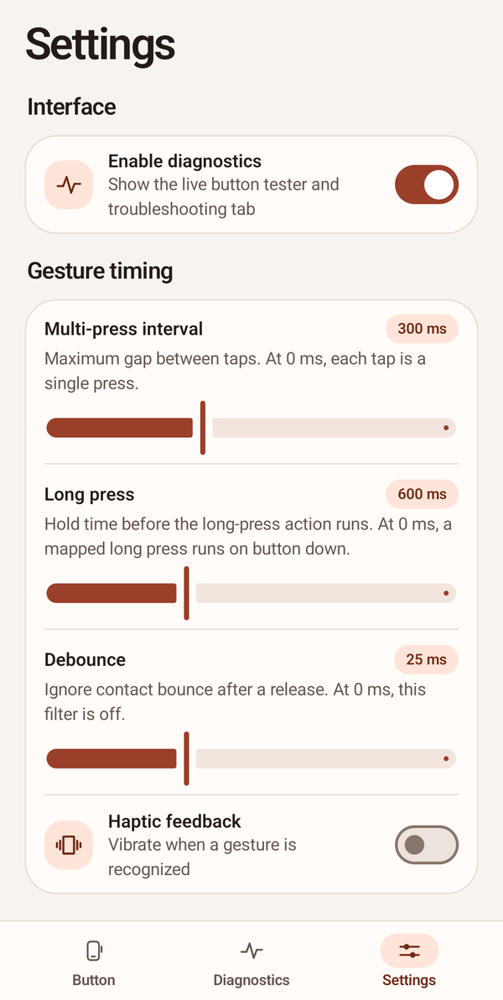

  

<h1 align="center">Xiaomi AI Button Remapper</h1>

  Turn the physical AI Button on Xiaomi 18 Pro and Xiaomi 18 Pro Max into a shortcut for the actions you use most.
   
  Powered by Shizuku. No root required.

  
  
  
  

  <strong><a href="https://github.com/migwynkriid13/Xiaomi-AI-Button-Remapper/releases/latest/download/Xiaomi-AI-Button-Remapper.apk">Download signed APK</a></strong>
  · <a href="#get-started">Get started</a>
  · <a href="https://github.com/migwynkriid13/Xiaomi-AI-Button-Remapper/releases">Release notes</a>

## Inside the app

  
  
  

## What you can do

Assign different actions to a **single press, double press, triple press, or long press**. Open Camera with one press, skip a track with two, or hold the button to turn on the flashlight.

| Feature | What you can assign |
| --- | --- |
| **Apps and shortcuts** | Open an [installed app](docs/screenshots/apps-light.png), a [supported app shortcut](docs/screenshots/shortcuts-light.png), a Settings page, or a link. |
| **Device controls** | Take a screenshot, lock the screen, go Back or Home, or open Quick Settings. |
| **Media and sound** | Play or pause, skip or seek, adjust volume, or change the ringer or Do Not Disturb mode. |
| **App profiles and conditions** | Give a gesture a different action in a specific app, or run it only when a condition is met, such as headphones being connected. |
| **Action sequences** | Run up to 12 steps from one gesture, with optional delays and repeats. |

You can tune gesture timing, export and import your settings, and choose whether Xiaomi's original action runs alongside your mapping.

## Get started

Use a **Xiaomi 18 Pro** or **Xiaomi 18 Pro Max** with the dedicated AI Button and an up-to-date HyperOS build.

1. Install the [latest signed APK](https://github.com/migwynkriid13/Xiaomi-AI-Button-Remapper/releases/latest/download/Xiaomi-AI-Button-Remapper.apk).
2. Install Shizuku and start it through wireless debugging. [Shizuku setup guide](https://shizuku.rikka.app/guide/setup/#start-via-wireless-debugging)
3. Open the remapper and tap **Grant Shizuku access**. Press and release the AI Button when the button test starts. **DOWN** and **UP** confirm the app can read it. Use **Test button** to repeat the check. [Setup screen](docs/screenshots/setup-light.png)
4. Choose an action for a gesture and turn on **Remap button**.

Keep Shizuku running while remapping. After restarting your phone, start Shizuku again and tap **Resume remapping**. HyperOS determines whether the AI Button sends presses while the phone is locked or the screen is off.

On a fresh launch, the app checks GitHub Releases. When a newer version is available, tap **Download APK** to open the signed update or **Later** to keep using your current version.

## How it works

Shizuku gives the app access to the physical button. The remapper recognizes your gesture and runs the action you assigned while passing power and volume events through to Android. Turn off **Remap button** or hold the AI Button for eight seconds to restore Xiaomi's normal behavior.

App profiles and configured screen interactions use optional Accessibility access. Per-app media controls require notification access. The action picker shows which actions need extra permissions. The remapper's own notifications are optional.

The app collects no analytics or telemetry. Settings stay on your device. A configured HTTP action sends its request when you trigger the assigned gesture.

## Project links

- **Troubleshooting.** Open **Settings → Enable diagnostics** to see button detection and session status. If you report a problem, include your phone model, HyperOS version, and button test result. [GitHub Issues](https://github.com/migwynkriid13/Xiaomi-AI-Button-Remapper/issues)
- **Development.** Find the build requirements and test procedures in the project documentation. [Build workflow](.github/workflows/android.yml) · [Device testing](docs/device-testing.md) · [Emulator testing](docs/emulator-testing.md) · [Verification record](docs/verification.md)
- **License.** The project is open source under the GNU General Public License v3. [License](LICENSE) · [Third-party notices](THIRD_PARTY.md)
