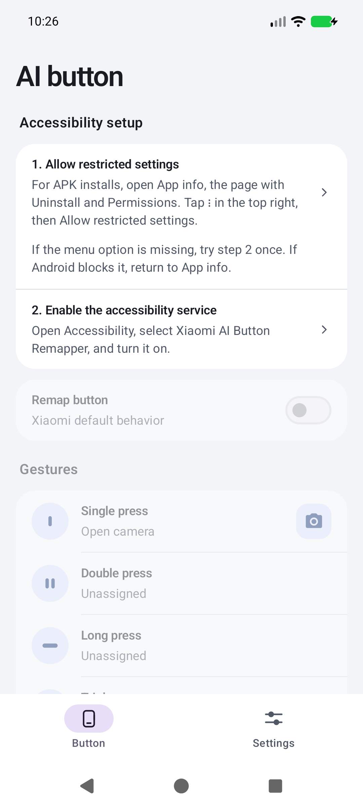
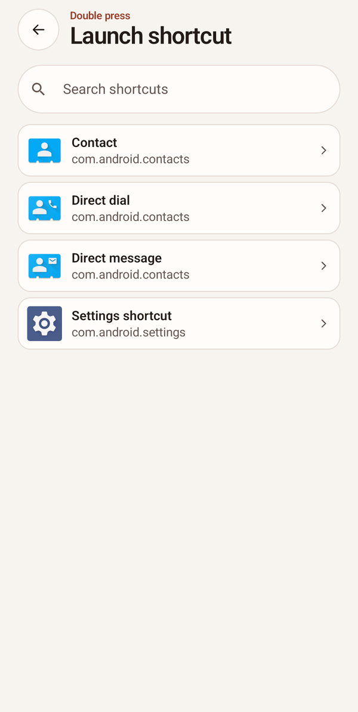

# Xiaomi AI Button Remapper

Assign the physical AI button on a Xiaomi 18 Pro to Camera, Screenshot, an app shortcut, media controls, or an action sequence. Single, double, triple and long presses can have different actions. The app uses one Android accessibility service for button input and remapping. Setup takes place on the phone.

[Download the latest signed APK](https://github.com/migwynkriid13/Xiaomi-AI-Button-Remapper/releases/latest/download/Xiaomi-AI-Button-Remapper.apk) · [All releases](https://github.com/migwynkriid13/Xiaomi-AI-Button-Remapper/releases)

   

## Set up on Android 11 or later

1. Install the APK and open the app. On Android 13 or later, tap **Allow restricted settings** to open **App info**, the system page with Uninstall and Permissions. Open the **⋮** menu and select **Allow restricted settings**. On some Android builds the menu appears only after the system blocks the first attempt to enable the service. [Google Android Help](https://support.google.com/android/answer/12623953)
2. Return to the app and tap **Enable the accessibility service**. Select **Xiaomi AI Button Remapper** in Android Accessibility, turn it on and confirm the system prompt. The setup instructions disappear and the mapping controls become available.
3. Configure a gesture, switch on **Remap button**, and try it with the screen on. To take a screenshot, open any gesture and choose **Button actions → Take screenshot**. Android's screenshot interface saves the image in the usual location.
4. To see key events, turn on **Enable diagnostics** in the app's Settings. Open the new **Diagnostics** tab and **Listen without remapping**. Press and release the physical button and look for both edges. Try **Learn alternate key** if Diagnostics shows a possible match.

The hardware target is Linux scan 689 (`KEY_MACRO_RECORD_STOP`, `0x2B1`), normally on a physical `gpio-keys` device. The tester lists Android's separate key code when it sees the event. HyperOS may intercept the key before Android delivers it to an accessibility service. The old raw-input preview could listen on the owner's phone, which does not establish delivery through Accessibility. See the [physical test procedure](docs/device-testing.md) and [verification record](docs/verification.md).

When moving from the original `v0.1.0-preview.1` debug-signed APK, export your settings, uninstall that preview, install this release, then import. The official signed releases use the same certificate and normally update in place. If Android Settings shows the service as on while the app still shows setup, turn it off and back on.

## Actions and options

- **Apps, shortcuts and Settings.** Search installed launchable apps, shortcut creators, and supported Settings destinations. Android provides app and shortcut artwork. Launcher-published shortcuts require shortcut-host access. Legacy creators can supply the selected shortcut's own artwork.
- **Device and navigation.** Camera, screenshot, flashlight and supported torch strength, Home, Back, Recents, app menu, D-pad navigation, lock screen, Quick Settings and notification shade. Some options depend on the Android version. Connectivity changes can open a system panel for confirmation.
- **Media and sound.** Playback and seek actions, including actions that target a particular installed media player. Per-app media and notification dismissal use Android's optional notification access. Choose a ringtone or audio file, adjust a volume stream, control the ringer, or change Do Not Disturb with permission.
- **App profiles and conditions.** Override any gesture for a foreground app. The other gestures continue to use their defaults. Add per-gesture conditions for screen state, lock, media, Wi-Fi, charging, orientation or headphones. A failed condition skips the mapped action. Turn on **Also run Xiaomi's action** to pass through the physical button while remapping is enabled.
- **Automation.** Run a sequence of up to 12 actions with delays and repetitions. Other options include selected touch and editor operations, UI element interaction, URL, Android intents, HTTP requests, local variables, and supported phone or SMS actions. The picker shows extra access when an action needs it.

The app reads the active window's package for an app profile when a press begins. A configured app element or shade action inspects the active unlocked window only when it runs and **UI interactions** is on. The app does not store window contents or record typed text. Accessibility setup grants these capabilities through one Android service. No analytics or telemetry are collected. A configured HTTP action sends the request you provided when its gesture runs. Exported JSON may contain endpoint details, text, or phone numbers.

Previously saved shell and privileged mappings remain visible as unavailable so the rest of an older backup can be imported. Replace these mappings with actions supported by Accessibility.

## Background operation and stop controls

Android manages the remapper's accessibility service. It can run with the settings screen closed, and the saved Remap button switch applies when Android reconnects the service. Device firmware controls whether the service is available before the first unlock and whether it receives a press with the screen off.

Turn off **Remap button**, use **Emergency disable** from Diagnostics, or hold the button for eight seconds while events are being delivered. If you allow notifications, the active status notification also offers **Stop now**. Notification access for per-app media is separate and is needed only for actions that use it.

If HyperOS stops the service in the background, check the app's **Background autostart** and battery setting in App info. [Xiaomi autostart](https://www.mi.com/uk/support/faq/details/KA-507608/) · [Xiaomi battery settings](https://www.mi.com/global/support/faq/details/KA-538010/)

## Build and release

Use JDK 21, Android SDK Platform 37.0, Build Tools 36.0.0 and the included Gradle wrapper. Set `ANDROID_HOME` or configure the SDK in Android Studio.

```sh
./gradlew assembleDebug testDebugUnitTest lintDebug
```

The debug APK is written to `app/build/outputs/apk/debug/app-debug.apk`. On Windows use `gradlew.bat`. Android's debug and official release certificates differ.

GitHub Actions publishes a signed APK only when a push to `main` changes an APK input. Documentation and screenshots alone skip the build and release. Tests, debug sources and CI configuration can run verification without publishing. The release's signing certificate is pinned in [gradle/release-certificate.sha256](gradle/release-certificate.sha256).

[Device testing](docs/device-testing.md) · [Emulator testing](docs/emulator-testing.md) · [License and attributions](THIRD_PARTY.md)
