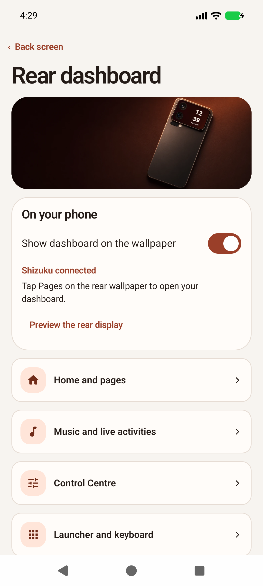
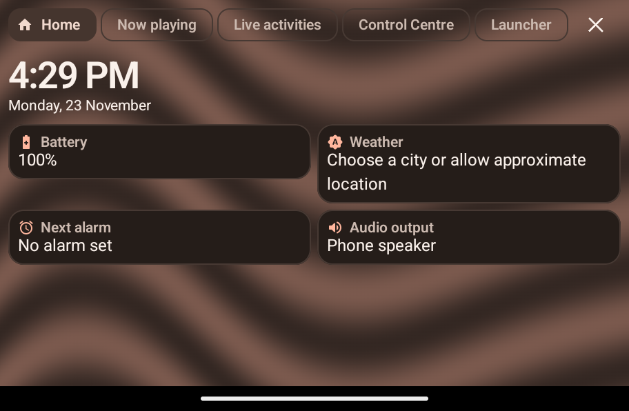

# Rear dashboard

Open **Back screen → Rear dashboard**, start Shizuku and grant access. Enable **Show dashboard on the wallpaper**, then tap **Pages** on the rear screen. The close button returns to the wallpaper. **Preview the rear display** on the front shows your configured pages at the proportions of the detected panel or a selected Xiaomi model.



## Set up the rear display



| In the front editor | On the rear screen |
| --- | --- |
| **Home and pages** | Select and order pages and home cards. Choose compact or expanded cards and assign separate tap and hold actions. Calendar titles require calendar permission. Accessory battery readings depend on the connected device. |
| **Music and live activities** | Choose album art or a spinning record, player colors and timed lyrics. Enable the remapper’s media session notification listener in Android settings. Seek, transport and notification actions depend on what the source app exposes. |
| **Control Centre** | Pin actions from the existing button action picker, including sequences. Set labels and icons. Eligible actions have an additional lock-screen toggle. The rear controls include brightness, radios, ringer, a dashboard screenshot and silent MP4 recording of the dashboard window for up to one minute. Captures appear in the system media library. |
| **Launcher and keyboard** | Pin installed apps, set their order, choose a grid or carousel, and set density and window width per app. Swipe up on the wallpaper from just above the system gesture strip, or open the Launcher page. Tap an icon on the unlocked rear screen. The system keyboard uses Android’s per-display IME policy. The optional compact keyboard uses Accessibility and routes input to a focused text field in the rear app. Xiaomi firmware and guest apps determine which window sizes and keyboard routes they accept. |
| **Always-on and appearance** | Set the idle delay, dim clock, date, battery, weather, badges and edge glow. Choose a clock style, font, photo, video or animated background. Video supports start and end times, reverse, loop, once and ping-pong playback. Pocket mode blanks the dashboard when the supported sensor reports cover. |
| **Pinned notes and photos** | Write a note or share text or an image to **Pin to back screen**. Adjust the crop on the front, then save. Page through up to 24 pins and zoom images on the rear. Assign **Crop front screen to back** to a gesture for screen snippets. The optional three-finger shortcut uses Android touch exploration, which changes touch navigation while enabled. |
| **Connections** | Choose the data and endpoints for weather, Home Assistant, a JSON card and two usage rings. Configure each lens position, metric, color and companion. |
| **Profiles** | Desk, Headphones and Night can each select a landing page, brightness and timeout. Triggers include charging, connected headphones, playback, device lock and night hours (22:00–07:00). When several match, Night takes precedence, followed by Headphones and Desk. |

**Live activities** shows supported calls, alarms, navigation instructions, rides, timers and downloads. Slide an available call or alarm action to confirm. Ride details, turn icons, progress and actions depend on the notification supplied by the app. **Notifications** lets you dismiss individual cards or clear the list. Choose whether dismissals also reach the phone. The optional banner over a rear app displays its source app’s name. **Tap garden** keeps your best score on the device.

### Typing in a rear app

These captures show text entered by tapping keys on the simulated rear display. The first uses Android’s keyboard in Settings search. The second uses the optional compact keyboard in a Contacts text field.

| Android system keyboard | Compact rear keyboard |
| --- | --- |
|  |  |

## Connections

- **Weather.** Set a city and temperature unit, or optionally give approximate location access to use a last-known position. Current conditions and automatic weather effects use [Open-Meteo](https://open-meteo.com/).
- **Synced lyrics.** Enabling lyric lookup sends track title, artist, album and duration to [LRCLIB](https://lrclib.net/). Lyrics appear when a timed entry exists.
- **Home Assistant.** Enter your HTTPS server URL, save a token, then select **Browse entities** or enter an entity ID. Set a service such as `light.toggle` for the rear action. The token is encrypted using Android Keystore and bound to the configured server. Changing the server requires saving its token. [Home Assistant REST API](https://developers.home-assistant.io/docs/api/rest/)
- **Custom JSON.** Give the card a label, an HTTPS endpoint and a dot-separated field path. For example, `rooms.0.temperature` displays the first temperature in `{"rooms":[{"temperature":21.5}]}`. The card shows the time of its latest successful reading.
- **Claude usage.** Each account reads a user-selected JSON document or an HTTPS feed. To use Claude Code status-line data, make the status JSON available to the phone and keep that file or endpoint updated. Choose a five-hour, seven-day or supplied scoped weekly window, then usage percentage or time until reset. You can also use a ring for phone battery. [Claude Code status line](https://code.claude.com/docs/en/statusline)

Example usage data for the first two windows, with reset times expressed as Unix seconds:

```json
{
  "rate_limits": {
    "five_hour": { "used_percentage": 32, "resets_at": 1800000000 },
    "seven_day": { "used_percentage": 17, "resets_at": 1800400000 }
  }
}
```

Connected pages require an unlocked phone. The separate lock-screen option for calls and alarms exposes only supported actions that Android allows. Secret notifications and other users’ notifications are filtered. Pinned images and notes are stored privately on the device until removed or evicted by the pin limit.
