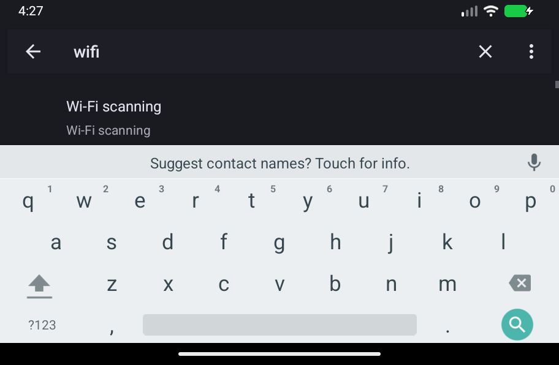
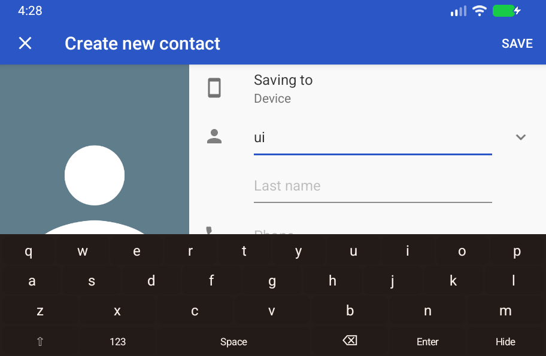

# Rear display overlays

Open **Back screen**, start Shizuku and grant access. Choose a background and turn on the features you want. Each switch applies to its own overlay. The front preview shows the wallpaper and the selected overlay together. Use **Restore Xiaomi rear display** under **Display behavior** to return to the stock display.

## Wallpaper and layers

| Front settings | On the rear display |
| --- | --- |
| **Background** | Choose the wallpaper gallery, a solid color, a photo, a video clip, or an animated scene. The gallery supports GIFs, folders, rotation and panning. Video has crop or fit, trim points, and loop, once, reverse and ping-pong playback. Adjust the color and animation speed of shader backgrounds in the live preview. |
| **Clock** | Show time on the wallpaper and choose the face, font, date and battery details. The gallery editor also offers the draggable gallery clock. |
| **Notification banners** and **Charging animation** | A temporary overlay on arrival or plug-in. Notification appearance, privacy, pull-down access and charging animation styles can be adjusted from their rows. |
| **Lens rings** | Draw battery or usage rings near the camera. Choose where the rings appear and adjust each companion. |
| **Always-on** and **Pocket mode** | Set the idle timeout, choose which details appear on the dim black face and optionally blank the display when covered. |

## On-demand overlays

Tap the small overlay button to pick an enabled overlay. Closing the sheet, tapping outside it, or leaving it idle returns to the wallpaper. Active playback can also show a track shortcut directly on the wallpaper.

| Front settings | On the rear display |
| --- | --- |
| **Glance cards** | Select and order readings, choose compact or expanded cards, and assign tap and hold actions. Calendar titles and accessory readings use their respective permissions. |
| **Now playing**, **Live activities**, and **Notifications** | Choose album art, lyrics, and the types of live activity to show. Android notification access is needed for the remapper’s media session listener. Available controls depend on the source app. |
| **Control Centre** | Pin actions from the button action picker and assign labels and icons. Eligible actions can be available while locked. Rear controls also include dashboard screenshots and silent video recording. |
| **Open an app** | Pin apps and set their rear sizing. Open a pinned app from the sheet, or swipe up from the wallpaper when the gesture is enabled. The optional compact keyboard uses Accessibility to type into the focused rear app. |
| **Pinned notes and photos** | Write a note or share an image or text to **Pin to back screen**. The optional three-finger capture shortcut uses Android touch exploration. |
| **Connected cards** | Configure weather, Home Assistant, a JSON card and usage data sources. |
| **Overlay shortcuts** | Reorder the enabled overlays or enable Tap garden. |
| **Automatic profiles** | Desk, Headphones and Night profiles can set brightness and the idle timeout, and optionally show an enabled overlay. Night takes precedence, followed by Headphones and Desk. |

While locked, app handoff and private overlays are hidden. Supported call and alarm sliders are available while locked only if explicitly allowed. Notification privacy and source-app restrictions still apply.

### Typing in a rear app

These captures show text entered by tapping keys on the simulated rear display. The first uses Android’s keyboard in Settings search. The second uses the optional compact keyboard in a Contacts text field.

| Android system keyboard | Compact rear keyboard |
| --- | --- |
|  |  |

## Connections

- **Weather.** Set a city and temperature unit, or optionally give approximate location access to use a last-known position. Current conditions and automatic weather effects use [Open-Meteo](https://open-meteo.com/).
- **Synced lyrics.** Enabling lyric lookup sends track title, artist, album and duration to [LRCLIB](https://lrclib.net/). Lyrics appear when a timed entry exists.
- **Home Assistant.** Enter your HTTPS server URL, save a token, then select **Browse entities** or enter an entity ID. Set a service such as `light.toggle` for the rear action. The token is encrypted using Android Keystore and bound to the configured server. Changing the server requires saving its token. [Home Assistant REST API](https://developers.home-assistant.io/docs/api/rest/)
- **Custom JSON.** Give the card a label, an HTTPS endpoint and a dot-separated field path. For example, `rooms.0.temperature` displays the first temperature in `{"rooms":[{"temperature":21.5}]}`. The card shows the time of its latest successful reading.
- **Claude usage.** Each account reads a user-selected JSON document or an HTTPS feed. To use Claude Code status-line data, make the status JSON available to the phone and keep that file or endpoint updated. Choose a five-hour, seven-day or supplied scoped weekly window, then usage percentage or time until reset. Each account can have a Sprout, Firefly or Cat companion on its lens ring and connected card. Choose wallpaper visibility and animation separately. You can also use a ring for phone battery. [Claude Code status line](https://code.claude.com/docs/en/statusline)

Example usage data for the first two windows, with reset times expressed as Unix seconds:

```json
{
  "rate_limits": {
    "five_hour": { "used_percentage": 32, "resets_at": 1800000000 },
    "seven_day": { "used_percentage": 17, "resets_at": 1800400000 }
  }
}
```

Connected cards require an unlocked phone. The separate lock-screen option for calls and alarms exposes only supported actions that Android allows. Secret notifications and other users’ notifications are filtered. Pinned images and notes are stored privately on the device until removed or evicted by the pin limit.
